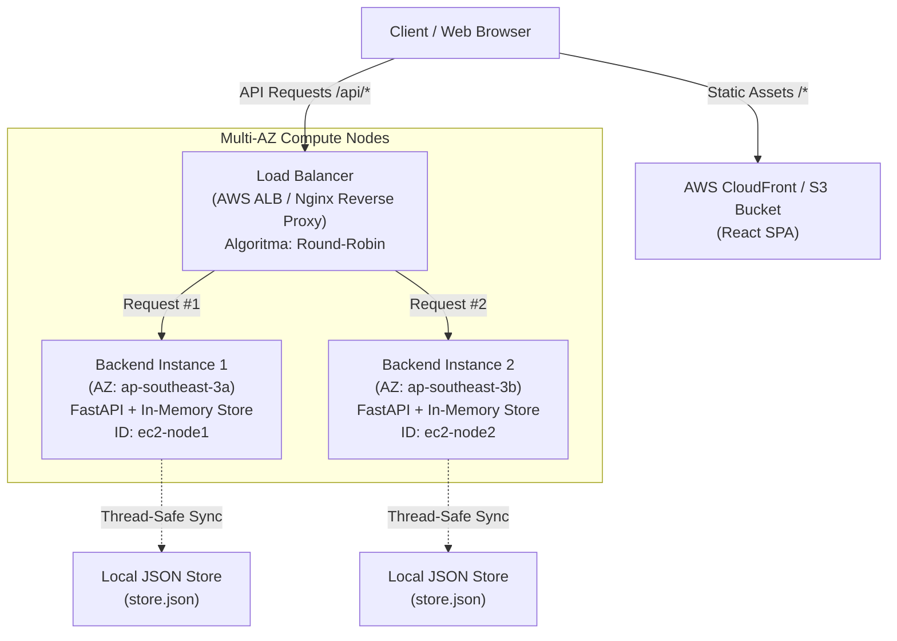

# MotoRent Cloud 🚗🏍️
### Sistem Manajemen Penyewaan Kendaraan Terdistribusi Berbasis Cloud
**Mata Kuliah:** CAK3EAB3 Komputasi Awan dan Terdistribusi  
**Program Studi:** S1 Teknik Informatika  
**Institusi:** Telkom University Purwokerto  

---

## 📌 Ringkasan Proyek

**MotoRent Cloud** adalah aplikasi web penyewaan kendaraan modern dengan arsitektur terdistribusi (*decoupled architecture*) yang dirancang khusus untuk memenuhi standar mata kuliah Komputasi Awan dan Terdistribusi. 

Sistem ini memisahkan antarmuka pengguna (*Frontend Presentation Layer*) dan pemrosesan logika bisnis (*Backend Compute Nodes*), serta siap di-deploy pada lingkungan multi-instance dengan **Load Balancer (Round-Robin)** di cloud publik (AWS).

> [!IMPORTANT]
> **Kepatuhan Batasan Akademik Proyek Kuliah:**
> Sesuai ketentuan tugas, sistem ini **sama sekali tidak menggunakan database eksternal** (seperti MySQL, PostgreSQL, SQLite, atau MongoDB). Seluruh persistensi data dikelola secara *in-memory* di dalam proses Python dengan proteksi *thread-safe re-entrant lock* (`threading.RLock`) dan sinkronisasi otomatis berkala ke file lokal `backend/data/store.json`.

---

## 🚀 Fitur Utama

### 1. Katalog & Manajemen Armada (*Fleet Management*)
- Katalog interaktif untuk unit **Motor** dan **Mobil** lengkap dengan tarif sewa harian.
- Filter kategori (*Semua*, *Motor*, *Mobil*) dan pencarian cepat berdasarkan model atau plat nomor.
- Manajemen CRUD armada (tambah, perbarui, dan hapus unit).
- Proteksi integritas data: unit yang sedang berstatus `Rented` tidak dapat dihapus dari sistem.

### 2. Manajemen Pelanggan (*Customer Directory*)
- Pendaftaran pelanggan dengan validasi format kontak dan nomor Surat Izin Mengemudi (SIM).
- Skema status kelayakan pelanggan: `Active` (dapat menyewa) dan `Blacklisted` (dilarang menyewa).
- Modal riwayat sewa individual untuk melihat seluruh transaksi masa lalu dan total biaya sewa yang telah dibelanjakan.
- Proteksi integritas data: pelanggan yang masih memiliki transaksi sewa aktif (`Ongoing`) tidak dapat dihapus.

### 3. Engine Transaksi Sewa & Pengembalian (*Rental Lifecycle*)
- Transaksi sewa atomik multi-entitas yang mengikat Customer, Armada, dan Rental.
- Pencegahan otomatis pemesanan ganda (*double-booking prevention*) dan penolakan pelanggan berstatus *Blacklisted*.
- Siklus hidup transaksi lengkap:
  - **Booking**: Menghitung total biaya sewa berdasarkan durasi hari dan mengubah status unit menjadi `Rented`.
  - **Return (Pengembalian)**: Mencatat timestamp pengembalian, mengubah status sewa menjadi `Completed`, dan secara atomik merestorasi unit menjadi `Available`.
  - **Cancel (Pembatalan)**: Membatalkan sewa yang sedang berlangsung dan mengembalikan unit ke status `Available`.

### 4. Telemetri Cloud & Pembuktian Load Balancing
- Middleware backend secara otomatis menyematkan header HTTP `X-Instance-Id` pada setiap respon API.
- Indikator telemetri *real-time* di navbar antarmuka web, menampilkan identitas instance/node yang memproses request pengguna.
- Terintegrasi dengan Nginx / AWS Application Load Balancer untuk demonstrasi algoritma **Round-Robin** secara bergantian antar-node.

---

## 🏗️ Arsitektur Sistem



---

## 🛠️ Tech Stack

| Layer | Komponen & Teknologi | Deskripsi |
| :--- | :--- | :--- |
| **Backend** | Python 3.12+, FastAPI, Uvicorn | RESTful API cepat, asinkron, dan modular |
| **Data Layer** | In-Memory `JsonStore` (`threading.RLock`) | Mematuhi aturan proyek tanpa external database |
| **Frontend** | React 18, Vite, TypeScript | Antarmuka SPA modern, responsif, & type-safe |
| **Styling & UI** | Tailwind CSS v4, Lucide Icons | Desain bersih berstandar WCAG 2.2 AA Contrast |
| **Testing** | Pytest, Pytest-Asyncio, HTTPX | 24 Automated Unit Tests (100% Passing) |
| **Orchestration** | Docker, Docker Compose, Nginx | Simulasi Multi-Node Load Balancing lokal |
| **Cloud Target** | AWS EC2 (Multi-AZ), ALB, S3, CloudFront | Arsitektur target produksi komputasi awan |

---

## 💻 Panduan Menjalankan Secara Lokal

### Prasyarat
- Python 3.12 atau versi lebih baru.
- Node.js v18+ dan npm.

### 1. Menjalankan Backend (FastAPI)
```bash
# Buka terminal dan masuk ke folder backend
cd backend

# Buat dan aktifkan virtual environment (Windows)
python -m venv .venv
.\.venv\Scripts\activate

# (Atau jika di Linux/macOS: source .venv/bin/activate)

# Install dependensi
pip install -r requirements.txt

# Jalankan server FastAPI
uvicorn app.main:app --reload --host 127.0.0.1 --port 8000
```
- Dokumentasi Interaktif Swagger UI: [http://127.0.0.1:8000/docs](http://127.0.0.1:8000/docs)
- Endpoint Telemetri Node: [http://127.0.0.1:8000/api/info](http://127.0.0.1:8000/api/info)

### 2. Menjalankan Frontend (React + Vite)
```bash
# Buka terminal baru dan masuk ke folder frontend
cd frontend

# Install dependensi node modules
npm install

# Jalankan development server
npm run dev
```
Akses aplikasi melalui browser di: [http://localhost:5173](http://localhost:5173)

### 3. Menjalankan Pengujian Unit (*Automated Pytest Suite*)
```bash
# Dari root repository (menggunakan venv backend)
.\backend\.venv\Scripts\pytest.exe -c backend/pytest.ini backend/tests/
```
*(Seluruh 24 skenario pengujian unit akan dieksekusi dan terverifikasi hijau).*

---

## 🐳 Simulasi Cloud Terdistribusi & Load Balancing (Docker Compose)

Untuk membuktikan konsep sistem terdistribusi dan *Round-Robin load balancing* pada komputer lokal:

1. **Build bundle frontend produksi:**
   ```bash
   cd frontend
   npm run build
   cd ..
   ```

2. **Jalankan kluster multi-node dan load balancer:**
   ```bash
   docker compose up --build
   ```

3. **Layanan yang berjalan:**
   - **Load Balancer (Nginx)**: `http://localhost:8080`
   - **Backend Node 1**: `http://localhost:8001` (`INSTANCE_ID=ec2-ap-southeast-3a-node1`)
   - **Backend Node 2**: `http://localhost:8002` (`INSTANCE_ID=ec2-ap-southeast-3b-node2`)

4. **Uji Rotasi Round-Robin via Terminal:**
   ```powershell
   # PowerShell (Windows)
   1..6 | ForEach-Object {
       (Invoke-WebRequest -Uri "http://localhost:8080/api/info" -Method Head).Headers["X-Instance-Id"]
   }
   ```
   *Output akan berotasi bergantian antara `ec2-ap-southeast-3a-node1` dan `ec2-ap-southeast-3b-node2`.*

---

## 📂 Struktur Direktori Proyek

```text
MotoRent-Cloud/
├── backend/
│   ├── app/
│   │   ├── routers/         # Endpoint API (customers, vehicles, rentals)
│   │   ├── engine.py        # Business logic deep module transaksi sewa
│   │   ├── main.py          # Entrypoint FastAPI & telemetry middleware
│   │   ├── schemas.py       # Validasi skema data Pydantic
│   │   └── store.py         # Thread-safe in-memory store & JSON sync
│   ├── data/
│   │   └── store.json       # Seed & persistent snapshot data lokal
│   ├── tests/               # 24 Automated unit tests
│   ├── Dockerfile           # Kontainerisasi backend produksi
│   └── requirements.txt
├── frontend/
│   ├── src/
│   │   ├── components/      # Komponen UI (Katalog, Pelanggan, Transaksi)
│   │   ├── api.ts           # Client API & fetch wrapper
│   │   ├── App.tsx          # Main shell & tab switcher
│   │   └── tokens.css       # Design system tokens (WCAG AA compliant)
│   └── package.json
├── nginx/
│   └── nginx.conf           # Konfigurasi reverse proxy & load balancer
├── docs/adr/                # Architectural Decision Records (ADRs)
├── docker-compose.yml       # Simulasi multi-node cloud lokal
├── DEPLOYMENT.md            # Panduan lengkap deployment produksi AWS
├── SPEC.md                  # Spesifikasi teknis formal sistem
├── GLOSSARY.md              # Kamus domain model & terminologi
└── README.md                # Dokumentasi utama proyek
```

---

## 📚 Tautan Dokumentasi Terkait

- 📘 [Panduan Deployment AWS & Analisis Kuliah (DEPLOYMENT.md)](DEPLOYMENT.md)
- 📋 [Dokumen Spesifikasi Teknis Lengkap (SPEC.md)](SPEC.md)
- 📖 [Kamus Istilah Domain Model (GLOSSARY.md)](GLOSSARY.md)

---

## 👥 Anggota Kelompok

Proyek tugas besar ini dikerjakan oleh Kelompok dari kelas Komputasi Awan dan Terdistribusi:

| No | Nama Lengkap | NIM | 
| :-: | :--- | :--- | 
| 1 | Marzhendo Galang Saputra | 103112400102 | 
| 2 | Aedil Riski Ansyah | 103112400101 | 
| 3 | Ryan Muhammad Saputra | 103112400109 |
| 4 | Maruf Sarifudin | 103112400128 | 

---
*Dikembangkan untuk Tugas Praktikum Komputasi Awan dan Terdistribusi — Telkom University Purwokerto.*
