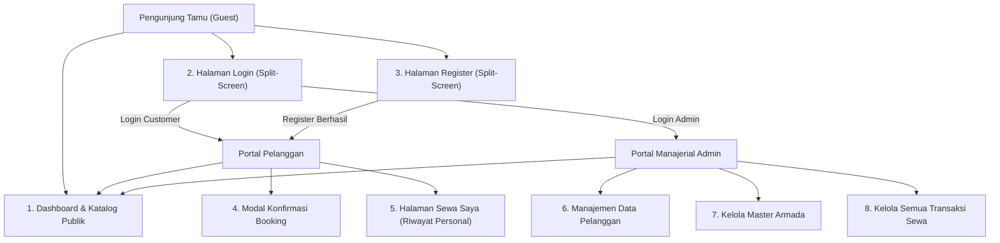
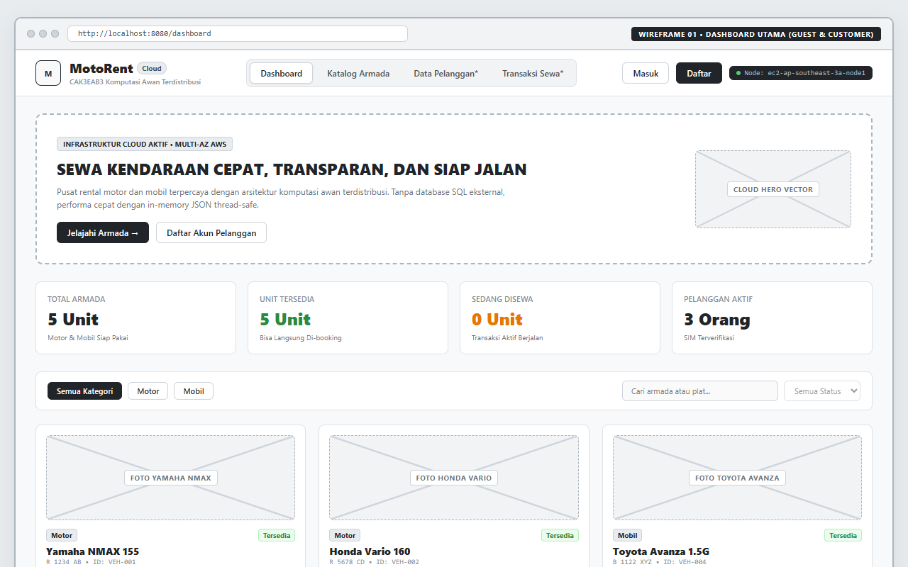
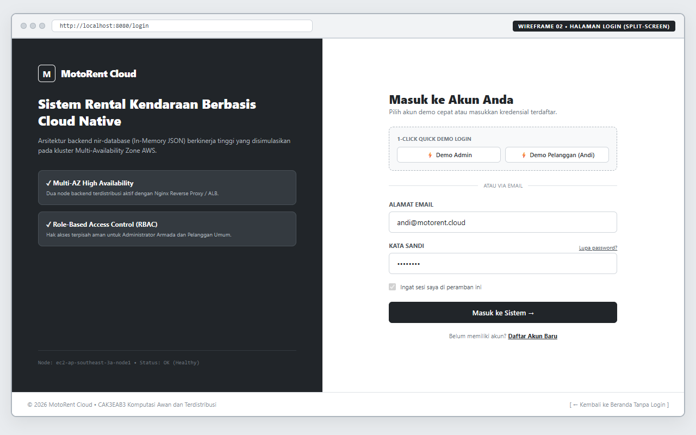
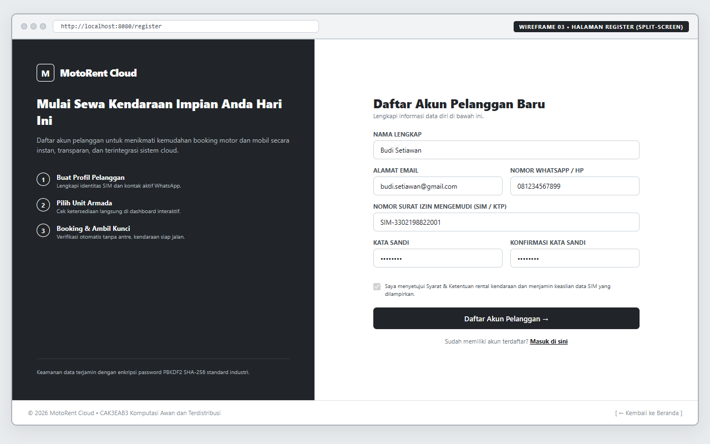
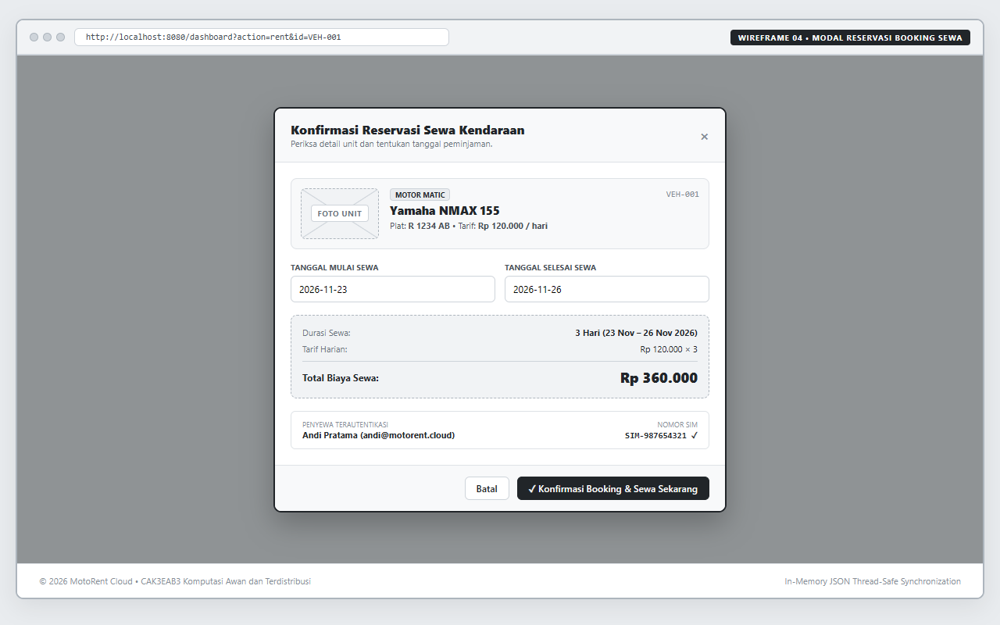
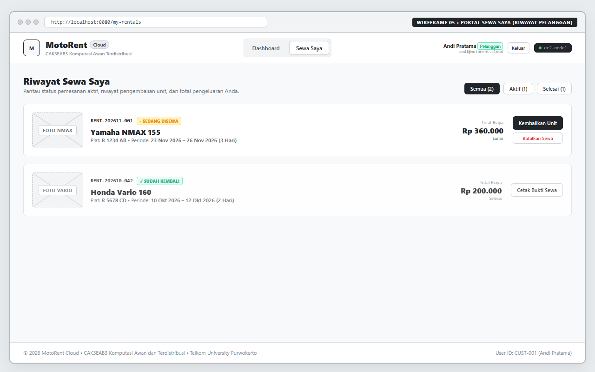
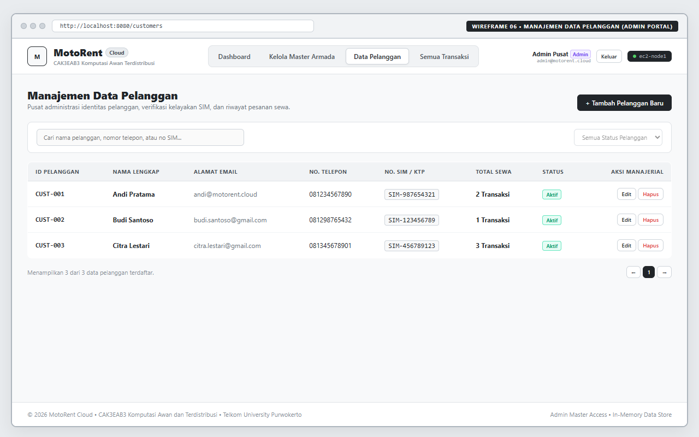
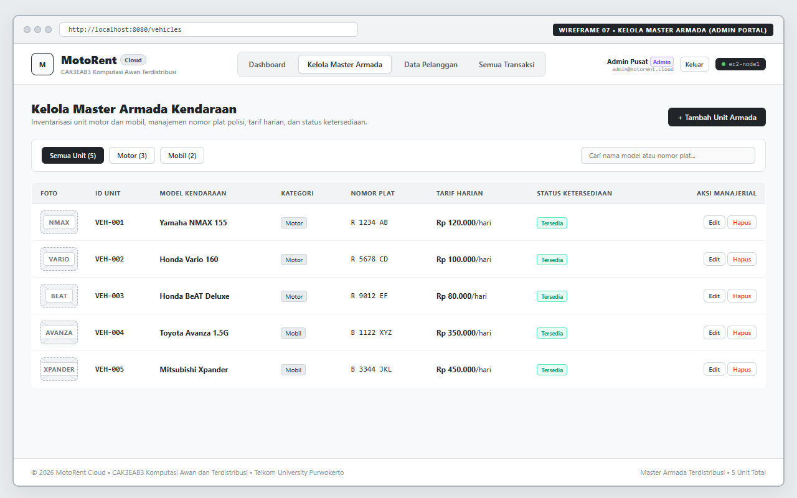
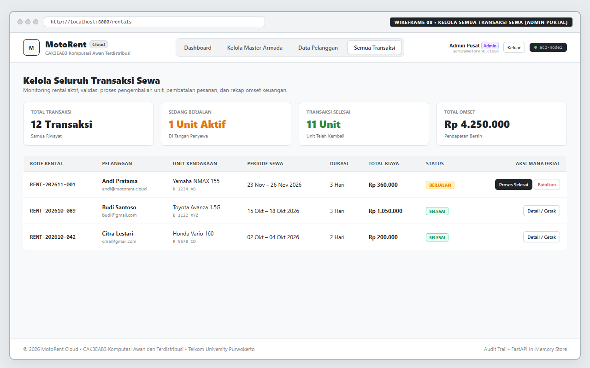

# Dokumen Wireframe Antarmuka Front-End (UI/UX)
## MotoRent Cloud — CAK3EAB3 Komputasi Awan dan Terdistribusi
### Institut Teknologi Telkom Purwokerto (Telkom University Purwokerto)

---

## 📌 Daftar Isi & Struktur Halaman

Dokumen ini memuat rancangan tata letak (*wireframe*), hierarki visual, dan penjelasan komponen antarmuka pengguna (*front-end*) untuk seluruh halaman aplikasi **MotoRent Cloud** sebagai pemenuhan laporan akademik tugas praktikum komputasi awan.

## 📌 Daftar Berkas Gambar Wireframe Low-Fi (Tugas 10)

Seluruh gambar rancangan antarmuka (*low-fidelity wireframe*) telah di-generate dengan format gambar beresolusi tinggi (PNG 1280x800) dan tersimpan di direktori `docs/wireframes/`. Anda dapat langsung menyalin (*copy-paste*) atau menyisipkan (*insert picture*) berkas gambar ini ke dalam dokumen laporan Word / Google Docs **Tugas 10**:

| No | Halaman / Antarmuka | Berkas Gambar Wireframe (PNG) | Peran Pengguna (*Role*) |
| :---: | :--- | :--- | :---: |
| **01** | **Dashboard & Katalog Utama** | [`docs/wireframes/01-dashboard.png`](./wireframes/01-dashboard.png) | Publik & Pelanggan |
| **02** | **Halaman Login (Split-Screen)** | [`docs/wireframes/02-login.png`](./wireframes/02-login.png) | Publik / Pengguna |
| **03** | **Halaman Registrasi Pelanggan** | [`docs/wireframes/03-register.png`](./wireframes/03-register.png) | Pengunjung Baru |
| **04** | **Modal Dialog Booking Sewa** | [`docs/wireframes/04-booking-modal.png`](./wireframes/04-booking-modal.png) | Pelanggan & Admin |
| **05** | **Portal Sewa Saya (Histori Sewa)** | [`docs/wireframes/05-my-rentals.png`](./wireframes/05-my-rentals.png) | Pelanggan Terautentikasi |
| **06** | **Manajemen Data Pelanggan** | [`docs/wireframes/06-customer-management.png`](./wireframes/06-customer-management.png) | Administrator |
| **07** | **Kelola Master Armada Kendaraan** | [`docs/wireframes/07-fleet-catalog-admin.png`](./wireframes/07-fleet-catalog-admin.png) | Administrator |
| **08** | **Kelola Semua Transaksi Sewa** | [`docs/wireframes/08-rental-management-admin.png`](./wireframes/08-rental-management-admin.png) | Administrator |

---

## 📌 Alur Navigasi Antarmuka Pengguna



---

## 1. Wireframe: Halaman Dashboard Utama (Public & Customer)

Halaman utama yang diakses pengguna saat membuka aplikasi. Berisi navigasi atas komersial yang bersih, hero banner mobilitas modern, metrik statistik langsung, grid kartu armada interaktif berfoto asli, serta edukasi alur dan FAQ sewa.



```text
+---------------------------------------------------------------------------------------------------------------+
|  [LOGO] MotoRent [Cloud]   | [Dashboard]  [Kelola Armada*]  [Data Pelanggan*]  [Semua Transaksi*] | [Masuk] [Daftar]|
|  Rental Motor & Mobil      | (Tamu: [Dashboard]) (Customer: [Dashboard]  [Sewa Saya])        | [Profil User]   |
+---------------------------------------------------------------------------------------------------------------+
|                                                                                                               |
|  +=========================================================================================================+  |
|  |  [★] Rental Motor & Mobil Terpercaya di Purwokerto                                                      |  |
|  |                                                                                                         |  |
|  |  SEWA MOTOR & MOBIL TANPA RIBET, SIAP JALAN.                                                            |  |
|  |  Pilihan armada prima di Purwokerto dengan tarif harian transparan, unit terawat berkala,                |  |
|  |  dan verifikasi SIM instan untuk kenyamanan mobilitas Anda.                                             |  |
|  |                                                                                                         |  |
|  |  (v) Unit Rutin Servis Resmi    (v) 100% Bersih & Disinfeksi    (v) Tarif Transparan & Pasti            |  |
|  |                                                                                                         |  |
|  |  [ Pilih Armada Sekarang -> ]   [ Masuk ke Akun ] / [ Sewa Saya ]                                       |  |
|  +=========================================================================================================+  |
|                                                                                                               |
|  +--------------------+  +--------------------+  +--------------------+  +--------------------+               |
|  | TOTAL ARMADA       |  | UNIT TERSEDIA      |  | SEDANG DISEWA      |  | PELANGGAN AKTIF    |               |
|  |      5 Unit        |  |      5 Unit        |  |      0 Unit        |  |     2 Pelanggan    |               |
|  | Motor & Mobil      |  | Siap Sewa Sekarang |  | Unit di Jalan      |  | Terverifikasi      |               |
|  +--------------------+  +--------------------+  +--------------------+  +--------------------+               |
|                                                                                                               |
|  Pilihan Armada Tersedia                                                                                      |
|  [ Semua Kategori ]  [ (o) Motor ]  [ [=] Mobil ]            [ Cari armada/plat... ] [Semua Status v] [R]     |
|                                                                                                               |
|  +-----------------------------+  +-----------------------------+  +-----------------------------+            |
|  | [ FOTO ASLI YAMAHA NMAX ]   |  | [ FOTO ASLI HONDA VARIO ]   |  | [ FOTO ASLI TOYOTA AVANZA ] |            |
|  | (•) Motor         [Tersedia]|  | (•) Motor         [Tersedia]|  | [=] Mobil         [Tersedia]|            |
|  |                             |  |                             |  |                             |            |
|  | Yamaha NMAX 155             |  | Honda Vario 160             |  | Toyota Avanza 1.5G          |            |
|  | [R 1234 AB] • VEH-001       |  | [R 5678 CD] • VEH-002       |  | [B 1122 XYZ] • VEH-004      |            |
|  |                             |  |                             |  |                             |            |
|  | [2 Kursi]      [Matic]      |  | [2 Kursi]      [Matic]      |  | [7 Kursi]      [Manual]     |            |
|  | Tarif Harian:               |  | Tarif Harian:               |  | Tarif Harian:               |            |
|  | Rp 120.000 /hari            |  | Rp 100.000 /hari            |  | Rp 350.000 /hari            |            |
|  |                             |  |                             |  |                             |            |
|  | [    Sewa Sekarang ->    ]  |  | [    Sewa Sekarang ->    ]  |  | [    Sewa Sekarang ->    ]  |            |
|  +-----------------------------+  +-----------------------------+  +-----------------------------+            |
|                                                                                                               |
|  3 Langkah Mudah Memulai Sewa:                                                                                |
|  [ 1. Pilih Kendaraan ] -------> [ 2. Tentukan Durasi ] -------> [ 3. Ambil & Siap Jalan ]                    |
|                                                                                                               |
|  Standar Keamanan & Kepercayaan MotoRent (4 Pilar Layanan) & Tanya Jawab Populer (FAQ)                        |
|                                                                                                               |
+---------------------------------------------------------------------------------------------------------------+
|  MotoRent Cloud • Hak Cipta Dilindungi • Telkom University Purwokerto   |  Cluster: ec2-node • FastAPI Engine |
+---------------------------------------------------------------------------------------------------------------+
```

### Penjelasan Komponen UI:
1. **Header / Navbar:** Logo vektor MotoRent Cloud, navigasi berbasis peran pengguna (Role-Based Access Control), profil kapsul terautentikasi (Andi Pratama / Administrator), serta tombol Masuk/Daftar bagi pengunjung umum tanpa badge teknis yang mengganggu.
2. **Hero Section:** Proposisi nilai komersial kelas industri mobilitas modern dengan pilar jaminan servis resmi, kebersihan unit, dan transparansi tarif harian.
3. **Quick Stats Grid:** 4 kartu metrik dinamis yang memantau inventaris armada total, unit tersedia, unit aktif berjalan, dan pelanggan aktif terdaftar.
4. **Fleet Cards Grid:** Kartu armada kendaraan berfoto asli studio (16:10), badge kategori, nomor plat registrasi, spesifikasi cepat (kapasitas kursi & transmisi), tarif sewa per hari, dan aksi pemesanan langsung dengan *state preservation* (otomatis membuka modal sewa pasca login).
5. **Edukasi & FAQ:** Bagian panduan 3 langkah mudah memesan armada dan 4 akordion FAQ untuk meningkatkan kepercayaan calon penyewa.
6. **Footer Komersial:** Direktori kategori armada, standar garansi, kontak operasional garasi, serta catatan kluster telemetri di sudut kanan bawah.

---

## 2. Wireframe: Halaman Autentikasi — Login (Split-Screen)

Halaman masuk akun bagi Pengguna dan Administrator, mengusung tata letak *Split-Screen* bertema *Tech Mobility Dark Slate* dengan fitur *1-Click Demo Login* yang mempermudah pengujian instan.



```text
+---------------------------------------------------------------------------------------------------------------+
|                                                                                                               |
|  +-------------------------------------+  +----------------------------------------------------------------+  |
|  | [<- Kembali ke Beranda]             |  | Masuk ke Akun Anda                                             |  |
|  |                                     |  | Masukkan email dan kata sandi untuk mengelola sewa kendaraan.  |  |
|  | [LOGO] MotoRent                     |  |                                                                |  |
|  | Rental Motor & Mobil                |  | ⚡ AKSES CEPAT AKUN DEMO (EVALUASI)                             |  |
|  |                                     |  | [ (Shield) Demo Admin ]       [ (User) Demo Pelanggan ]        |  |
|  | Mobilitas Andal untuk               |  | (admin@motorent.cloud)        (andi@motorent.cloud)            |  |
|  | Setiap Perjalanan Anda              |  |                                                                |  |
|  |                                     |  | --------- atau gunakan email terdaftar ----------------------- |  |
|  | Platform rental motor dan mobil     |  |                                                                |  |
|  | terpercaya. Nikmati tarif harian    |  | ALAMAT EMAIL *                                                 |  |
|  | jujur tanpa biaya tersembunyi, unit |  | [ @ nama@email.com                                          ]  |  |
|  | selalu prima, dan kemudahan sewa    |  |                                                                |  |
|  | langsung jalan.                     |  | KATA SANDI *                                                   |  |
|  |                                     |  | [ * ••••••••                                                ]  |  |
|  | (v) Tarif Harian Transparan Tanpa   |  |                                                                |  |
|  |     Biaya Tersembunyi               |  | [               Masuk ke Akun  ->                          ]  |  |
|  | (v) Unit Terawat Berkala di         |  |                                                                |  |
|  |     Bengkel Resmi                   |  | Belum memiliki akun? [Daftar Akun Pelanggan Baru]             |  |
|  | (v) Pengambilan Unit Tepat Waktu    |  |                                                                |  |
|  +-------------------------------------+  +----------------------------------------------------------------+  |
|                                                                                                               |
+---------------------------------------------------------------------------------------------------------------+
```

### Penjelasan Komponen UI:
1. **Panel Kiri (Branding Komersial):** Nuansa *dark slate* elegan dengan pencahayaan aksen biru/emerald, nilai jual layanan mobilitas tanpa embel-embel jargon komputasi awan.
2. **Panel Kanan (Formulir Masuk):** Input email dan kata sandi dengan validasi bersih dan keamanan hash PBKDF2.
3. **1-Click Quick Demo Bar:** Menyediakan akses sekali klik (*1-click instant login*) untuk menguji akun **Admin Operasional** maupun **Pelanggan Terdaftar (Andi Pratama)** tanpa harus mengetik manual.

---

## 3. Wireframe: Halaman Autentikasi — Register (Split-Screen)

Halaman pendaftaran mandiri pelanggan yang secara atomik membuat akun pengguna sekaligus entitas profil `Customer` aktif lengkap dengan nomor SIM.



```text
+---------------------------------------------------------------------------------------------------------------+
|                                                                                                               |
|  +-------------------------------------+  +----------------------------------------------------------------+  |
|  | [<- Kembali ke Beranda]             |  | Pendaftaran Akun Pelanggan Baru                                |  |
|  |                                     |  | Lengkapi data di bawah untuk mengaktifkan akun penyewa Anda.   |  |
|  | [LOGO] MotoRent                     |  |                                                                |  |
|  | Registrasi Pelanggan                |  | NAMA LENGKAP *                                                 |  |
|  |                                     |  | [ (User) Nama lengkap sesuai KTP/SIM                        ]  |  |
|  | Satu Akun untuk Semua               |  |                                                                |  |
|  | Kebutuhan Sewa Anda                 |  | ALAMAT EMAIL *               | KATA SANDI *                    |  |
|  |                                     |  | [ @ email@domain.com       ] | [ * ••••••••                  ] |  |
|  | Daftarkan diri Anda dalam 2 menit.  |  |                                                                |  |
|  | Verifikasi data SIM dilakukan       |  | NO. HANDPHONE / WA *         | NOMOR SIM (A / C) *             |  |
|  | langsung saat registrasi sehingga   |  | [ (Phone) 081234567890     ] | [ (Card) SIM-A / SIM-C        ] |  |
|  | Anda dapat langsung memesan armada  |  |                                                                |  |
|  | motor atau mobil kapan saja.        |  | [               Daftar Akun Sekarang ->                    ]  |  |
|  |                                     |  |                                                                |  |
|  | (v) Verifikasi SIM Langsung Aktif   |  | Sudah memiliki akun? [Masuk di sini]                           |  |
|  | (v) Pantau Sewa & Bukti Bayar       |  |                                                                |  |
|  | (v) Akses Sewa Ulang Instan         |  |                                                                |  |
|  +-------------------------------------+  +----------------------------------------------------------------+  |
|                                                                                                               |
+---------------------------------------------------------------------------------------------------------------+
```

### Penjelasan Komponen UI:
1. **Input Terpadu SIM & Kontak:** Form meminta Nama, Email, Password, No. WhatsApp, dan Nomor Surat Izin Mengemudi (SIM).
2. **Otomasi Multi-Entitas:** Sekali klik tombol daftar, sistem backend secara otomatis menyisipkan data ke koleksi `users` dan membuat entitas `customers` berstatus `Active`.

---

## 4. Wireframe: Modal Dialog Konfirmasi Pemesanan Sewa

Modal pop-up interaktif yang muncul saat pengguna memilih unit kendaraan yang ingin disewa.



```text
+-----------------------------------------------------------------------------------+
|  (*) Konfirmasi Pemesanan Sewa                                              [ X ] |
|  Transaksi Multi-Entitas: Pelanggan, Armada & Rental                              |
|-----------------------------------------------------------------------------------|
|                                                                                   |
|  +-----------------------------------------------------------------------------+  |
|  | [ICON]  MOBIL                                                  Tarif Harian |  |
|  |         Toyota Avanza 1.5G                                   Rp 350.000/hari |  |
|  |         [B 1122 XYZ] • VEH-004 • 7 Kursi • Manual                           |  |
|  +-----------------------------------------------------------------------------+  |
|                                                                                   |
|  PROFIL PELANGGAN PENYEWA *                                                       |
|  (Jika Login Customer):                                                           |
|  +-----------------------------------------------------------------------------+  |
|  | (Shield) Andi Pratama (Profil Akun Anda)                     [Terverifikasi]|  |
|  |          ID: CUST-001 • SIM: SIM-C-010293 • Status: Aktif                   |  |
|  +-----------------------------------------------------------------------------+  |
|                                                                                   |
|  (Jika Admin):                                                                    |
|  [ v Pilih Pelanggan: Siti Rahmawati (CUST-002) - SIM-A-029384 [Active]       ]  |
|                                                                                   |
|  DURASI SEWA (HARI) *                    PILIHAN CEPAT: [ 1 ] [ 3 ] [ 7 ] [ 14 ]  |
|  [  3  ] Hari                                                                     |
|                                                                                   |
|  +-----------------------------------------------------------------------------+  |
|  | RINCIAN BIAYA SEWA                                                          |  |
|  | Tarif Harian Kendaraan                        Rp 350.000                    |  |
|  | Durasi Sewa                                   x 3 Hari                      |  |
|  | --------------------------------------------------------------------------- |  |
|  | TOTAL PEMBAYARAN                              Rp 1.050.000                  |  |
|  +-----------------------------------------------------------------------------+  |
|                                                                                   |
|                                              [ Batal ]   [ Konfirmasi Sewa -> ]   |
+-----------------------------------------------------------------------------------+
```

### Penjelasan Komponen UI:
1. **Auto-Binding Customer Profile:** Jika Customer yang login, identitas dirinya langsung terkunci dan terverifikasi secara otomatis. Jika Admin, tersedia dropdown untuk memilih pelanggan.
2. **Kalkulator Biaya Real-Time:** Menghitung total biaya otomatis (`Tarif Harian x Jumlah Hari`) dengan preset tombol cepat 1, 3, 7, atau 14 hari.
3. **Pencegahan Double-Booking:** Transaksi diproses dalam blok *thread-safe re-entrant lock* backend untuk memastikan armada langsung beralih status menjadi `Rented`.

---

## 5. Wireframe: Halaman Riwayat Sewa Pelanggan ("Sewa Saya")

Halaman mandiri khusus pelanggan untuk memantau kendaraan yang sedang disewa serta histori penyewaan masa lalunya.



```text
+---------------------------------------------------------------------------------------------------------------+
|  Riwayat Sewa Saya                                                                                            |
|  Monitoring armada yang sedang Anda sewa dan riwayat transaksi sewa masa lalu Anda.                           |
|---------------------------------------------------------------------------------------------------------------|
|                                                                                                               |
|  Filter Status: [ Semua Status v ]           Cari ID Sewa / Armada: [ Cari transaksi...             ]  [R]    |
|                                                                                                               |
|  +---------------------------------------------------------------------------------------------------------+  |
|  | ID SEWA   | KENDARAAN DISEWA       | WAKTU SEWA & ESTIMASI KEMBALI   | BIAYA SEWA   | STATUS    | AKSI      |  |
|  |-----------+------------------------+---------------------------------+--------------+-----------+-----------|  |
|  | RENT-001  | Toyota Avanza 1.5G     | Mulai : 23 Nov 2026, 09:00 WIB  | Rp 1.050.000 | [Ongoing] | [Kembalikan|  |
|  |           | Plat: B 1122 XYZ       | Target: 26 Nov 2026, 09:00 WIB  | (3 Hari)     | (Kuning)  |   Armada] |  |
|  |-----------+------------------------+---------------------------------+--------------+-----------+-----------|  |
|  | RENT-003  | Honda Vario 160        | Selesai: 20 Nov 2026, 17:30 WIB | Rp 200.000   |[Completed]| [Detail   |  |
|  |           | Plat: R 5678 CD        | Dikembalikan Tepat Waktu        | (2 Hari)     | (Hijau)   |  Struk]   |  |
|  +---------------------------------------------------------------------------------------------------------+  |
|                                                                                                               |
+---------------------------------------------------------------------------------------------------------------+
```

---

## 6. Wireframe: Halaman Admin — Manajemen Data Pelanggan

Halaman manajerial untuk staf/admin guna mengelola direktori pelanggan, memantau nomor SIM, status kelayakan, serta memeriksa catatan riwayat sewa individual.



```text
+---------------------------------------------------------------------------------------------------------------+
|  Manajemen Data Pelanggan                                                      [ + Daftarkan Pelanggan Baru ] |
|  Direktori pelanggan rental, validasi identitas SIM, dan audit kelayakan sewa.                                 |
|---------------------------------------------------------------------------------------------------------------|
|                                                                                                               |
|  Filter Status: [ Semua Kelayakan v ]             Pencarian: [ Cari nama, telepon, atau SIM...      ]  [R]    |
|                                                                                                               |
|  +---------------------------------------------------------------------------------------------------------+  |
|  | ID PELANGGAN | NAMA LENGKAP     | NO. TELEPON   | NOMOR SIM     | STATUS KELAYAKAN | AKSI PENGELOLAAN    |  |
|  |--------------+------------------+---------------+---------------+------------------+---------------------|  |
|  | CUST-001     | Andi Pratama     | 081234567801  | SIM-C-010293  | [ Active ]       | [Histori] [Edit] [X]|  |
|  | CUST-002     | Siti Rahmawati   | 081398765402  | SIM-A-029384  | [ Active ]       | [Histori] [Edit] [X]|  |
|  | CUST-003     | Dimas Saputra    | 085611223303  | SIM-C-038475  | [ Blacklisted ]  | [Histori] [Edit] [X]|  |
|  +---------------------------------------------------------------------------------------------------------+  |
|                                                                                                               |
+---------------------------------------------------------------------------------------------------------------+
```

---

## 7. Wireframe: Halaman Admin — Kelola Master Armada

Halaman manajerial untuk staf/admin guna menambah armada baru, memperbarui tarif sewa harian, mengatur status pemeliharaan (*maintenance*), dan menghapus kendaraan yang tidak sedang disewa.



```text
+---------------------------------------------------------------------------------------------------------------+
|  Manajemen Master Armada Kendaraan                                                [ + Tambah Unit Armada ]    |
|  Kontrol inventaris motor & mobil, pemantauan status unit, dan penetapan tarif sewa.                          |
|---------------------------------------------------------------------------------------------------------------|
|                                                                                                               |
|  Kategori: [ Semua ] [ Motor ] [ Mobil ]     Status: [ Semua v ]      Cari: [ Cari model/plat... ]    [R]     |
|                                                                                                               |
|  +---------------------------------------------------------------------------------------------------------+  |
|  | ID UNIT | FOTO | MODEL KENDARAAN            | PLAT NOMOR | SPESIFIKASI       | TARIF /HARI  | STATUS | AKSI |  |
|  |---------+------+----------------------------+------------+-------------------+--------------+--------+------|  |
|  | VEH-001 | [IMG]| Yamaha NMAX 155 (Motor)    | R 1234 AB  | 2 Kursi • Matic   | Rp 120.000   |[Avail] |[E][X]|  |
|  | VEH-002 | [IMG]| Honda Vario 160 (Motor)    | R 5678 CD  | 2 Kursi • Matic   | Rp 100.000   |[Avail] |[E][X]|  |
|  | VEH-004 | [IMG]| Toyota Avanza 1.5G (Mobil) | B 1122 XYZ | 7 Kursi • Manual  | Rp 350.000   |[Rented]|[E][X]|  |
|  +---------------------------------------------------------------------------------------------------------+  |
|                                                                                                               |
+---------------------------------------------------------------------------------------------------------------+
```

---

## 8. Wireframe: Halaman Admin — Kelola Semua Transaksi Sewa

Halaman operasional sentral untuk memproses pengembalian kendaraan (*return*), pembatalan rental (*cancellation*), serta audit riwayat transaksi sewa seluruh pelanggan.



```text
+---------------------------------------------------------------------------------------------------------------+
|  Kelola Seluruh Transaksi Sewa                                                                                |
|  Monitoring transaksi sewa berjalan, proses pengembalian armada, dan audit histori sewa.                     |
|---------------------------------------------------------------------------------------------------------------|
|                                                                                                               |
|  Filter Status: [ Semua Status v ]             Pencarian: [ Cari ID rental, pelanggan, atau armada...  ] [R] |
|                                                                                                               |
|  +---------------------------------------------------------------------------------------------------------+  |
|  | ID SEWA   | PENYEWA (CUSTOMER) | ARMADA KENDARAAN   | DURASI & TARIF TOTAL | STATUS    | AKSI PETUGAS   |  |
|  |-----------+--------------------+--------------------+----------------------+-----------+----------------|  |
|  | RENT-001  | Andi Pratama       | Toyota Avanza 1.5G | 3 Hari • Rp 1.050.000| [Ongoing] | [ Selesaikan ] |  |
|  |           | (CUST-001)         | [B 1122 XYZ]       | Tarif: Rp 350.000/hr | (Kuning)  | [  Batalkan  ] |  |
|  |-----------+--------------------+--------------------+----------------------+-----------+----------------|  |
|  | RENT-002  | Siti Rahmawati     | Yamaha NMAX 155    | 2 Hari • Rp 240.000  | [Completed| [ Cetak Struk ]|  |
|  |           | (CUST-002)         | [R 1234 AB]        | Returned: 22 Nov     | (Hijau)   |                |  |
|  +---------------------------------------------------------------------------------------------------------+  |
|                                                                                                               |
+---------------------------------------------------------------------------------------------------------------+
```

---

## 9. Rangkuman Aturan Desain & Aksesibilitas (WCAG 2.2 AA)

1. **Rasio Kontras Warna (Minimum 4.5:1 untuk teks normal):**
   - Teks Utama: Slate-950 (`#020617`) di atas Slate-50 (`#f8fafc`) dengan rasio kontras 15.8:1.
   - Status Tersedia (*Available*): Teks `#065f46` di atas `#ecfdf5` dengan rasio kontras 7.2:1.
   - Status Disewa (*Rented*): Teks `#92400e` di atas `#fffbeb` dengan rasio kontras 7.1:1.
   - Status Perawatan (*Maintenance*): Teks `#991b1b` di atas `#fef2f2` dengan rasio kontras 7.4:1.
2. **Desain Responsif (*Mobile First / Breakpoints*):**
   - `Desktop (> 1024px)`: Layout multi-kolom (3 kolom kartu armada, split-screen login 5:7).
   - `Tablet (768px - 1023px)`: 2 kolom kartu armada, tabel dengan horizontal scrollbar halus.
   - `Mobile (< 768px)`: 1 kolom penuh, navigasi hamburger/overflow, formulir bertumpuk vertikal.
